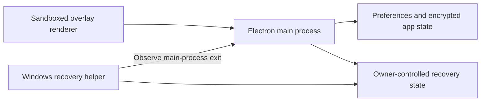

# OpenCluely recovery and durable checkpoints — 2.5.2

This implementation uses the existing Electron main process and an independent per-user Windows helper. The helper observes the main process through Windows process-exit events. It does not use a continuous ping loop. Version 2.5.2 improves local state saving; the native helper and its relaunch behavior are unchanged from 2.5.1. Mutual resurrection, process hiding, injection and termination-control bypass are not implemented.

## Source structure

| File | Responsibility |
| --- | --- |
| `overlay/main.js` | Electron lifetime, window configuration, provider connections, UI position and sleep/session-end checkpoints. |
| `overlay/recovery.js` | Start/adopt the verified helper, publish the current process identity, and handle owner enable/pause/complete-exit controls. |
| `overlay/native/recovery-helper.cs` | Independent C# user-mode worker: Windows process-exit notifications, state-file changes, bounded existing relaunch backoff and session-end disarm. |
| `overlay/checkpoint-writer.js` | Throttle dirty snapshots and retry synchronous save failures, without starting or keeping any process alive. |
| `overlay/interrupted-work.js` | Capture submitted questions and partial answers, encrypt checkpoints and restore them for manual review. |
| `overlay/storage.js` | Exclusive staging file, complete write, `fsyncSync`, close and atomic replacement. Encryption uses Electron `safeStorage`. |



The diagram describes supervision and data ownership, not a privileged security boundary. The helper remains visible to normal process tools. Ending the helper prevents it from reopening the app; the main process does not automatically resurrect the helper. Pause, Quit completely, Windows shutdown and sign-out retain priority over recovery. See [automatic reopening](AUTOMATIC-REOPENING.md) for exact controls and limits.

## Main application loop

The production structure in `overlay/main.js` uses documented Electron events. The following shortened extract shows the data-saving order; the source also handles IPC, tray actions, renderer reloads and Windows session-end notifications.

```js
const geometryCheckpoint = new CheckpointWriter({
  interval: 350,
  write: persistGeometry,
  report: () => warn('Window position could not be saved. Check available storage.')
});

win.on('move', () => geometryCheckpoint.mark());
win.on('resize', () => geometryCheckpoint.mark());

powerMonitor.on('suspend', () => {
  geometryCheckpoint.mark();
  geometryCheckpoint.flush();
  interruptedWork.flush();
  active?.controller.abort();
});
```

Window movement is throttled at approximately 350 ms instead of waiting until movement stops. Streamed answer checkpoints are throttled at approximately one second. A failed save retries after its normal interval, doubles subsequent retry delays to a maximum of 30 seconds, and saves the latest pending snapshot. A quiet stream still retries. Successful saves reset the delay; clean state has no write timer. Clear/history opt-out cancels the relevant pending writes. Timers are `unref()`'d and never prolong process lifetime.

These intervals are scheduling targets, not deadlines: CPU starvation, a blocked event loop, disk contention and OS scheduling can delay them. Provider/API configuration continues to use the existing validated synchronous save transaction; an unsuccessful replacement does not silently become the permanent configuration.

## Existing Windows helper loop

`RecoverySupervisor` in `overlay/native/recovery-helper.cs` already owns the worker lifecycle. Its `Watch` method attaches to the verified target process:

```csharp
identity.Process.Exited += (sender, args) => Post(() =>
{
    if (watched == identity) Reconcile();
});
identity.Process.EnableRaisingEvents = true;
if (identity.Process.HasExited) Post(Reconcile);
```

`Reconcile` checks the owner-controlled state and exact process identity. Existing retries wait about 2, 4, 8, 16, then 30 seconds, with a bounded replacement-process handshake. It uses standard .NET process management in the user's login session. It has no healthy-process ping timer, no extra persistent service and no automatic recovery for termination of the helper itself. The full worker source remains in the repository; no additional second supervisor has been added.

## Window level

The existing production configuration already satisfies ordinary desktop topmost behavior:

```js
const win = new BrowserWindow({ alwaysOnTop: true /* other existing options */ });
win.setAlwaysOnTop(true, 'screen-saver');
```

This sets the window stacking level. It does not increase CPU priority, prevent termination, guarantee visibility over every other topmost window, or override the Windows secure desktop.

## Preservation limits

Completed chats, submitted text checkpoints and provider credentials keep their existing encrypted formats. Preferences, including window bounds and selected provider/model, remain in the local configuration file. The previous committed file is preserved if staging or replacement fails. No migrations, dependencies, login flows or provider request formats change in this update.

Zero data loss cannot be promised. Text since the last successful checkpoint, unsent drafts and image pixels can still be lost. A first-run encryption profile must finish its initial persistence. Disk failure, power loss and complete resource exhaustion can prevent saving or reopening. Interrupted requests are never automatically resubmitted; restored text is for review and explicit retry. Normal window level flags do not solve resource exhaustion.

## Documented APIs

- [Electron BrowserWindow](https://www.electronjs.org/docs/latest/api/browser-window): window levels and Windows session-end notifications.
- [Electron powerMonitor](https://www.electronjs.org/docs/latest/api/power-monitor): suspend/resume events. The separate `shutdown` event is documented for Linux/macOS; Windows session end is handled through the existing window/helper notifications.
- [Node.js filesystem APIs](https://nodejs.org/api/fs.html#fsfsyncsyncfd): synchronous file flushing and rename operations.
- [.NET Process.EnableRaisingEvents](https://learn.microsoft.com/en-us/dotnet/api/system.diagnostics.process.enableraisingevents): process-exit notifications.
